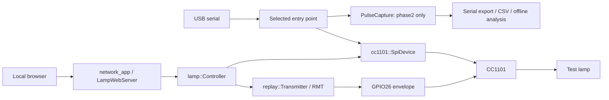

# Architecture

[简体中文](../zh-CN/architecture.md) · [Documentation](index.md)

The repository keeps one C++ codebase and selects entry points through PlatformIO source filters.
It does not run capture and the web transmitter concurrently.

<!-- section: environments -->
## Firmware environments

| Environment | Entry point | Purpose |
| --- | --- | --- |
| esp32dev | src/main.cpp | Reset/SPI identity and consecutive stability checks; no TX |
| phase2 | src/phase2_main.cpp | Serial-controlled OOK reception/capture; no Wi-Fi or TX |
| phase3 | src/phase3_main.cpp | Serial-controlled fixed-frame replay |
| phase4 (default) | src/phase4_main.cpp | Wi-Fi/HTTP interface to the same replay path |

Names reflect development phases, not released versions. Switching environments replaces the
application image; ordinary upload retains NVS.

<!-- section: modules -->
## Modules and ownership

| Module | Boundary |
| --- | --- |
| cc1101_identity.h | Pure identity/status validation and consecutive streaks |
| cc1101_spi.* | Ready timeouts, reset, verified registers/PATABLE, RX/TX/IDLE |
| pulse_capture.* | IRAM GPIO ISR, critical sections and bounded pre/post buffers |
| replay_plan.h / remote_frames.h | Pure bounds checks and generated measured waveforms |
| rf_replay.* | Finite RMT envelope, state checks and stop handling |
| lamp_controller.* | Whitelist dispatch, cooldown, actual-attempt count and fault latch |
| network_app.* | NVS, Wi-Fi lifecycle, Host/Origin/CSRF/auth checks and HTTP routes |
| lamp_web_server.h | Pinned-framework adapter: independent Digest and idle-client guard |
| trusted_devices.h / session_tokens.h | Persistent and RAM credential hashes |
| web/ | Chinese native HTML/CSS/JS UI and original artwork |
| scripts/ / tests/ | Collection, analysis, deterministic generation, software and real-device checks |

<!-- section: execution -->
## Execution and timing

The Arduino task serializes SPI and HTTP control. Wi-Fi callbacks never manipulate SPI.
RMT outputs an entire bounded waveform without loop mode or CPU refills. CPU completion checks
and SIDLE handling distinguish gateway success from actual lamp behavior; no lamp ACK is assumed.

The capture ISR records GPIO levels and esp_timer timestamps into static storage. It does not
allocate, print or call SPI. RSSI triggering happens outside the ISR. Bulk serial output begins
only after capture stops; overflow and ambiguous callbacks remain in exported quality fields.

The pinned HTTP server accepts one active client. The adapter yields a byte-free preconnection
only under contention after 200 ms; parsing and response handling otherwise use the framework.
It avoids the observed five-second head-of-line delay without patching installed dependencies.

<!-- section: web -->
## Web and storage design

The build merges CSS and vendored/auth/application JavaScript into a gzip HTML response.
Precise script/style CSP hashes avoid unsafe-inline. There is no frontend framework, CDN, web
filesystem or frontend build service. Static shell resources are public; device data and mutations
are authenticated. Login remains a normal form for password managers.

Network credentials are NVS records, not compiled secrets. Session/trust Cookies store random
tokens while the device retains hashes. API responses and serial machine keys stay compatible;
this documentation cleanup does not translate protocol keys or UI messages.
See [API](api.md), [Configuration](configuration.md) and [Security](../../SECURITY.md).
