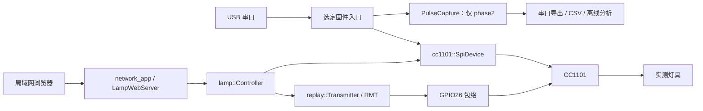

# 架构设计

[English](../en/architecture.md) · [文档导航](index.md)

项目保持单份 C++ 源码，通过 PlatformIO 源文件过滤选择入口，
不同时运行采集与 Web 发射固件。

<!-- section: environments -->
## 固件环境

| 环境 | 入口 | 用途 |
| --- | --- | --- |
| esp32dev | src/main.cpp | 复位、SPI 身份及连续稳定性检查，不发射 |
| phase2 | src/phase2_main.cpp | 串口控制 OOK 接收与采集，无 Wi-Fi、无发射 |
| phase3 | src/phase3_main.cpp | 串口控制固定波形重放 |
| phase4（默认） | src/phase4_main.cpp | 通过 Wi-Fi/HTTP 使用同一重放路径 |

名称来自开发阶段，不是发布版本号。切换环境会替换应用固件，普通上传保留 NVS。

<!-- section: modules -->
## 模块与职责

| 模块 | 职责边界 |
| --- | --- |
| cc1101_identity.h | 纯身份、状态校验及连续计数 |
| cc1101_spi.* | 就绪超时、复位、配置/PATABLE 回读、RX/TX/IDLE |
| pulse_capture.* | IRAM GPIO ISR、临界区及有界预触发/触发后缓冲 |
| replay_plan.h / remote_frames.h | 纯边界检查及生成的实测波形 |
| rf_replay.* | 有限 RMT 包络、状态检查及停止处理 |
| lamp_controller.* | 白名单分发、冷却、实际尝试计数及故障锁定 |
| network_app.* | NVS、Wi-Fi 生命周期、Host/Origin/CSRF/认证及 HTTP 路由 |
| lamp_web_server.h | 固定框架适配：独立 Digest 与空闲连接保护 |
| trusted_devices.h / session_tokens.h | 持久及 RAM 凭证哈希 |
| web/ | 中文原生 HTML/CSS/JS 界面及原创图形 |
| scripts/ / tests/ | 采集、分析、确定性生成、软件及真实设备检查 |

<!-- section: execution -->
## 执行与时序

Arduino 任务串行处理 SPI 与 HTTP 控制，Wi-Fi 回调不访问 SPI。
RMT 一次输出完整有界波形，不循环、不依赖 CPU 中途补数。
CPU 检查完成结果及 SIDLE，将网关发送成功与实际灯效区分，不假设灯具 ACK。

采集 ISR 将 GPIO 电平及 esp_timer 时间戳写入静态缓冲，不申请内存、不输出串口、不调用 SPI。
RSSI 触发在 ISR 外执行；采集停止后才批量输出串口。
溢出及有歧义的回调保留在导出质量字段中。

固定 HTTP 框架只处理一个活跃连接。适配器仅在竞争时、等待满 200ms 且尚无请求字节时
让出预连接，其余解析与发送沿用框架。该处理解决了观察到的五秒队首阻塞，
没有修改已安装依赖文件。

<!-- section: web -->
## 网页与存储

构建时将 CSS、固定版本第三方脚本、认证脚本及应用脚本合入 gzip HTML，
用精确 CSP 哈希允许脚本与样式，不开启 unsafe-inline。
没有前端框架、CDN、网页文件系统或前端构建服务。静态外壳公开，设备数据与修改操作需要认证。
登录保留标准表单以兼容密码管理器。

网络凭据作为 NVS 记录保存，不编译为密钥。Cookie 保存随机凭证，设备只保存哈希。
API 响应及串口机器字段保持兼容；本次整理不翻译协议键或界面提示。
详见 [API](api.md)、[配置说明](configuration.md)及[安全政策](../../SECURITY.zh-CN.md)。
